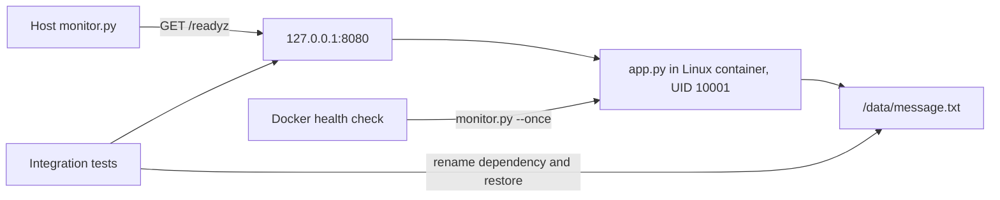

# UptimeDrill

A small Docker-based lab for monitoring service health, reproducing failures and testing recovery. It runs one Python HTTP service with a message-file dependency, a separate monitor and automated integration tests.

The drill removes the message file, checks which endpoints fail, identifies the cause in the logs and restores the file. The Linux container run and scoped cleanup have been verified locally. GitHub Actions execution remains pending. See [validation](VALIDATION.md) for results or go to [Docker Compose execution](#docker-compose-execution) to run it.

## Setup

```sh
git clone https://github.com/Marteeowo/UptimeDrill.git
cd UptimeDrill
```

Run the following commands from this directory. The Python app and tests use the standard library. Container execution requires a running Linux Docker engine and Docker Compose.

## Architecture



The app reads a message file. A separate host process polls readiness and reports HTTP results, request duration and changes between UP and DOWN. Docker uses the same readiness probe inside the container.

| Endpoint | Healthy | Missing or unreadable message |
| --- | --- | --- |
| `/` | 200 and message JSON | 503 |
| `/readyz` | 200 | 503 |
| `/livez` | 200 | 200 |
| Unknown route | 404 | 404 |

Liveness checks whether the HTTP process responds. Readiness checks whether it can read the content it serves. Docker marks the container unhealthy after repeated readiness failures. Restoring the file recovers the same process without restarting it.

## Run locally

Use Python 3.11 or newer and PowerShell 7. Run commands from this folder. Both programs use the Python standard library and connect only through `127.0.0.1` by default. If port 8080 is in use, pass the same free port to both programs with `--port` and use it in the example URLs. Container and CI configurations select Python 3.13.

In terminal 1, create the lab fixture and start the service.

```powershell
New-Item -ItemType Directory -Path .lab-state -Force
Copy-Item -LiteralPath fixtures/message.txt -Destination .lab-state/message.txt
python app.py --message-file .lab-state/message.txt
```

In terminal 2, start the monitor.

```powershell
python monitor.py
```

The monitor reports readiness every two seconds after each check. It records a UTC timestamp, the HTTP result or connection error, and elapsed time for the request. Look for `UP HTTP 200` before starting the drill.

## Rehearse an incident

Run these commands in a third terminal. Rename only the lab fixture created above.

1. Confirm the app serves its message, then simulate the missing file.

   ```powershell
   curl.exe -i http://127.0.0.1:8080/
   Rename-Item -LiteralPath .lab-state/message.txt -NewName message.offline
   ```

2. Wait for `DOWN CHANGE HTTP 503` in terminal 2. Compare the endpoints, then inspect terminal 1 for `message dependency unavailable (FileNotFoundError)`.

   ```powershell
   curl.exe -i http://127.0.0.1:8080/livez
   curl.exe -i http://127.0.0.1:8080/readyz
   curl.exe -i http://127.0.0.1:8080/
   ```

   `/livez` should return 200 because the HTTP process is still responding. `/readyz` and `/` should return 503 because the app cannot load the message it serves.

3. Restore the file and verify that the same running service can serve the message again. Wait for `UP CHANGE HTTP 200`.

   ```powershell
   Rename-Item -LiteralPath .lab-state/message.offline -NewName message.txt
   curl.exe -i http://127.0.0.1:8080/
   ```

4. Stop both processes with `Ctrl+C`. To repeat the drill, start both programs again with the restored fixture. If a previous run stopped mid-drill, rename `message.offline` back to `message.txt` before restarting.

On Linux, use `mkdir -p .lab-state`, `cp fixtures/message.txt .lab-state/message.txt`, `mv` to rename the fixture, and `curl` for the same HTTP requests. The Python commands are identical when Python is available as `python`.

`python monitor.py --once` exits 0 for readiness and 1 for failure. `--interval 0.5` changes polling frequency. The defaults use two-second polling and localhost binding.

## Docker Compose execution

Use a running Linux Docker Engine and Docker Compose v2 or newer. Docker Desktop supplies both on Windows. Image builds need network access to the official Python registry. Run this lab under its own Compose project name.

```powershell
docker compose --project-name cred-lab config --quiet
docker compose --project-name cred-lab up --build -d --wait --wait-timeout 60
docker compose --project-name cred-lab ps
docker compose --project-name cred-lab exec -T app id
docker compose --project-name cred-lab exec -T app uname -s
python monitor.py
```

The image runs as UID/GID 10001. The app listens on `0.0.0.0` inside the container so Docker can forward requests. Compose publishes it only at `127.0.0.1:8080` on the host. The message starts as an image fixture under `/data` in the container's disposable writable layer. The build context includes only the app, monitor and fixture.

For a port conflict, set `$env:CRED_PORT = '8081'` before starting Compose, then use `python monitor.py --port 8081` and port 8081 for HTTP requests. On Linux, use `export CRED_PORT=8081`.

## Container incident exercise

With the monitor running, use another terminal to rename the fixture in this container.

```powershell
docker compose --project-name cred-lab exec -T app python -c "from pathlib import Path; Path('/data/message.txt').rename('/data/message.offline')"
curl.exe -i http://127.0.0.1:8080/livez
curl.exe -i http://127.0.0.1:8080/readyz
curl.exe -i http://127.0.0.1:8080/
docker compose --project-name cred-lab logs --tail 30 app
docker compose --project-name cred-lab ps
```

Expected results are liveness 200, readiness/application 503, a `FileNotFoundError` warning, a DOWN transition and eventually Docker's `unhealthy` status. The Docker probe runs every two seconds, allows a three-second startup period and requires two failures. Health status therefore changes later than an individual HTTP response.

Recover and confirm that the message is served again.

```powershell
docker compose --project-name cred-lab exec -T app python -c "from pathlib import Path; Path('/data/message.offline').rename('/data/message.txt')"
curl.exe -i http://127.0.0.1:8080/
docker compose --project-name cred-lab ps
```

Wait for `UP CHANGE HTTP 200` and `healthy`. Stop this app to check transport failure.

```powershell
docker compose --project-name cred-lab stop app
```

Expect `DOWN CHANGE` followed by a connection error or timeout. Stop the monitor with `Ctrl+C`. Remove this lab's containers and network after the exercise.

```powershell
docker compose --project-name cred-lab down
docker compose --project-name cred-lab ps --all
```

If interrupted mid-incident, restore `message.offline` before continuing. If the container was removed, `up` creates a fresh one from the original image fixture. Exercise changes are disposable.

## Automated verification

Run syntax validation and the local suite from this folder.

```powershell
python -m compileall -q app.py monitor.py tests
python -m unittest discover -s tests -v
docker compose config --quiet
```

The suite has two tests. The operations drill checks healthy, failure, recovery, unknown-route and monitor behavior over real HTTP, including one-shot exit codes. The other test checks empty files, invalid UTF-8 and Unicode recovery. Local tests use temporary data and an automatically assigned port.

When Docker is running, enable the container backend.

```powershell
$env:CRED_TEST_DOCKER = '1'
try {
    python -m unittest discover -s tests -v
} finally {
    Remove-Item Env:CRED_TEST_DOCKER
}
```

On Linux, use `CRED_TEST_DOCKER=1 python -m unittest discover -s tests -v`.

The container suite generates a unique `cred-test-*` project, builds the image, starts Compose, selects an available localhost port and checks the same scenario. It additionally asserts Linux, a non-root user and Docker healthy/unhealthy/healthy transitions, and prints container logs. Cleanup runs on assertion failures, removes that project's containers, network and locally named image, then checks for remaining containers. Docker build cache may remain.

If the test process is forcibly killed, use the `cred-test-*` project name shown in the output to run `docker compose --project-name NAME down --rmi local`. Keep cleanup scoped to that test project.

## GitHub Actions

[ci.yaml](.github/workflows/ci.yaml) runs on push, pull request and manual dispatch. It uses an Ubuntu runner, Python 3.13 and commit-pinned checkout/setup actions. Its token has `contents: read`, and checkout disables credential persistence.

The job validates syntax, runs the local suite, validates Compose, then runs container tests with build, startup, incident injection, recovery and cleanup. An additional `always()` cleanup step handles step failures. Required checks return failing status on failure. CI logs contain HTTP samples, monitor transitions and container logs.

Run commands from the repository root, where `.github/workflows/ci.yaml` is located.

## Evidence and limitations

- [Incident 001](INCIDENT-001.md) preserves the original local drill.
- [Incident 002](INCIDENT-002.md) records the verified Linux container outage, recovery, logs and cleanup, alongside the earlier local results.
- [Validation](VALIDATION.md) lists checks and results.

This lab uses Python's development HTTP server and an intentional file dependency. Readiness is specific to that dependency. It has no authentication, TLS, database, persistent data, external alert delivery or production hardening. Probe durations are individual samples, and polling cannot establish exact outage boundaries. Docker health status reports failure but does not itself restart this Compose service.

The Python image uses a version tag, so future builds can receive upstream changes. Action commits are pinned. The workflow has not run on GitHub. Image and action references are available in the [official Python image](https://hub.docker.com/_/python/tags?name=3.13-slim) and [GitHub Python workflow documentation](https://docs.github.com/en/actions/tutorials/build-and-test-code/python).

AI assistance was used during development. The incident records identify how the checks were executed.

## Troubleshooting

| Symptom | Check and response |
| --- | --- |
| Cannot connect to Docker API | Start a Linux Docker engine, then rerun `docker version` before container tests |
| Port 8080 already allocated | Choose `CRED_PORT` and use that port in the monitor and HTTP commands |
| 503 immediately on startup | Check the message path, permissions, encoding and content; inspect app logs |
| 200 liveness with failed readiness | Compare `/`, `/readyz` and the missing-file log |
| Container stays unhealthy after recovery | Restore `/data/message.txt`, then allow the next probe to run |
| Local test import errors | Run `unittest discover` from this folder |
| Workflow absent on GitHub | Place this folder's `.github` directory at the approved repository root |
